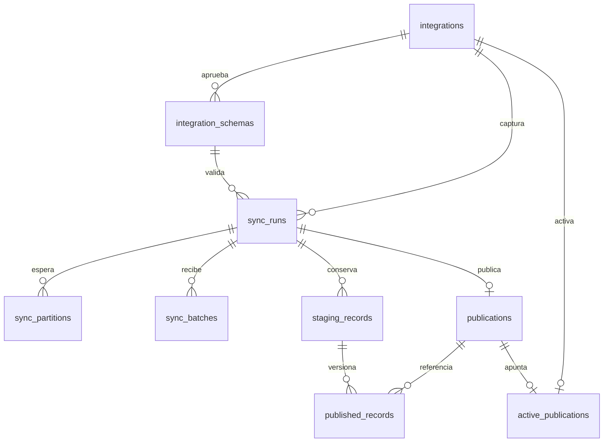

# Arquitectura y decisiones

```mermaid
flowchart LR
  SQL[(SQL Server privado LAN/VPN)] -->|SP permitidos + TLS| Agent[Agente Windows]
  Agent --> Validate[Metadatos aprobados + validación de filas]
  Validate --> Spool[Spool AES-GCM por UUID]
  Spool --> Seal[Finalización SQL + verificación + sellado]
  Seal -->|HTTPS saliente autenticado| API[Laravel 12 / PHP 8.3]
  API --> Staging[(MySQL 8 InnoDB: staging cifrado)]
  Staging --> Verify[Finalización: hashes / ordinales / totales]
  Verify --> Pub[Versión inmutable]
  Pub --> Pointer[Puntero activo: transacción atómica]
  Pointer --> Reader[API de lectura por dataset + scope]
  Reader --> Clients[Sistemas autorizados]
```

No existe conexión del VPS al SQL Server. El servidor no envía SQL ni nombres de SP al agente. Sólo la lista compilada y revisada del agente decide qué procedimiento ejecutar. Actualmente no se admite ningún parámetro.

## Semántica

Cada ejecución constituye un multiconjunto ordenado de observaciones recientes. La API declara `mode=ROLLING_WINDOW_CAPTURE`, `exhaustive=false`, publicación, ejecución y ordinal. Dos filas iguales siguen siendo dos registros. Un empleado ausente en la siguiente captura no se elimina de versiones anteriores; la captura activa cambia, pero **no hay una tabla de padrón consolidado** ni una promesa de representar a todos los trabajadores.

| Modalidad | Requisito futuro | Estado actual |
|---|---|---|
| ROLLING_WINDOW_CAPTURE | Ventana móvil sin cursor fiable | Única modalidad habilitada |
| FULL | SP autorizado que garantice padrón completo y semántica de bajas | Rechazada |
| SNAPSHOT_PERIOD | Periodo delimitado y reproducible | Rechazada |
| INCREMENTAL | Cursor monotónico fiable, watermark, desempate, eliminaciones explícitas | Rechazada |
| BACKFILL | Rango histórico parametrizable y autorizado | Rechazada |

Las extensiones pueden implementar `Source` con un esquema y un `AsyncIterable<Row>`. Cambiar modalidad exige un contrato y un validador nuevos; no basta con editar el YAML. No se interpretan timestamps de las filas como cursores.

## Máquina de estados

Agente: extracción → lotes cifrados → final SQL correcto → manifiesto inmutable → verificación → `sealed` → transferencia → `finalized` → `published`.

Una extracción fallida deja evidencia local sin manifiesto sellado. No existe envío previo al sellado. La reanudación usa el mismo UUID y los mismos archivos; nunca vuelve a ejecutar SQL. El checkpoint local es orientativo: el listado remoto de lotes, con sus hashes, determina qué falta. La recuperación comprueba todo el spool antes de transmitir.

Servidor: `receiving` → `finalized` → `published`; `receiving/finalized` → `cancelled`. Los lotes se escriben en una transacción indivisible. Repetir una publicación devuelve su ID existente y no vuelve a cambiar el puntero después de un rollback.

## Modelo MySQL

`sync_partitions` guarda descriptores esperados e inmutables de lotes, no particiones físicas MySQL. `sync_batches` contiene acuses recibidos. Las claves únicas `(run_id, number)`, `(run_id, ordinal)` y `(publication_id, ordinal)` impiden duplicación técnica sin eliminar duplicados de negocio.

`published_records` referencia el staging inmutable, evitando duplicar PII. Se conserva staging mientras exista una publicación que lo referencia. La identidad de origen siempre incluye integración, ejecución y ordinal; no se usa `cod_trabajador` como clave global. `service_tokens` añade autenticación mediante hashes, scopes, origen, expiración y revocación. `audit_events` sólo guarda IDs, acciones y contadores.

El modelo se implementa con Query Builder para controlar inserciones masivas y bloqueos; no depende de eventos de modelos Eloquent. Todas las tablas de sincronización usan InnoDB. Las migraciones son aditivas y tienen claves foráneas; su `down()` es exclusivamente para revertir instalaciones de prueba, no para rollback de datos productivos.

## Publicación y concurrencia

Toda mutación bloquea primero la fila de integración y luego la ejecución, con reintento transaccional de deadlocks limitado a cinco intentos. Integraciones distintas disponen de filas de bloqueo distintas. Se verifica la integridad completa y la aprobación vigente del esquema antes de publicar.

La publicación inserta la versión y sus referencias sin exponerlas; el cambio de `active_publications` ocurre en la misma transacción. Un fallo de disco durante el cambio revierte toda la nueva publicación y conserva la anterior. Una ejecución más antigua que la activa no la reemplaza por una reanudación tardía. El rollback explícito exige el ID activo esperado, evitando que dos operadores se pisen.

Las lecturas capturan un ID de publicación al inicio de la solicitud. El cliente debe reutilizar `publicationId` entre páginas: así las siguientes páginas siguen leyendo la misma versión aunque cambie el puntero activo.

## Límites

La extracción usa streaming y backpressure; la memoria se acota al lote actual y al manifiesto de hasta 10.000 lotes. El receptor limita cada lote a 5.000 filas y 2 MiB canónicos. La verificación procesa un lote por vez. Publicar un millón de referencias dentro de una transacción puede ser costoso: medir con volumen real antes del VPS y, si hace falta, separar preparación de activación con un estado adicional sin relajar las garantías.

La primera versión no incluye consolidación de empleados, borrados de negocio, frontend administrativo, purga automática, alta disponibilidad ni validación contra SQL Server real.
